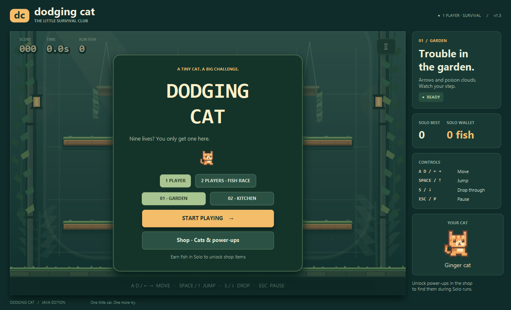
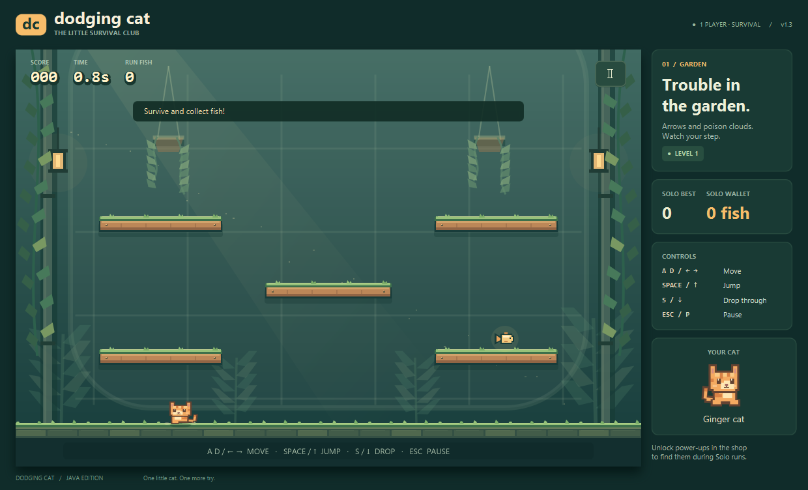

# Dodging Cat — Garden & Kitchen v1.3

Game sinh tồn 2D cho **máy tính**, viết bằng **Java + JavaFX**. Chơi một người hoặc **hai người đấu cá trên cùng bàn phím**, chọn bản đồ **Garden** hoặc **Kitchen**, nhảy giữa các bệ, né bẫy và gom cá. Toàn bộ chữ trong game dùng **tiếng Anh**; hướng dẫn này dùng tiếng Việt. Cập nhật tài liệu: **26/10/2026**.

Lối chơi lấy cảm hứng từ vòng lặp nhặt đồ và né bẫy của [Poor Bunny! — Adventure Islands trên Google Play](https://play.google.com/store/apps/details?id=com.adventureislands.poorbunny). Dodging Cat dùng nhân vật, bối cảnh và hình vẽ bằng mã riêng.





[Xem Garden và bẫy](docs/screenshots/garden-hazards.png) · [Xem Kitchen và bẫy](docs/screenshots/kitchen-hazards.png) · [Các tư thế hoạt ảnh mèo](docs/screenshots/cat-animation.png)

## Chơi ngay trên Windows

Giải nén **`DodgingCat-Windows-x64-v1.3.zip`**, mở thư mục `DodgingCat` và chạy **`Play.cmd`**. Bản này dành cho Windows x64, kèm runtime Java 23 và JavaFX 25, chạy offline; không cần cài JDK hoặc Maven. Cần giải nén toàn bộ thư mục để giữ `runtime/`, `lib/` và JAR cạnh launcher.

## Chạy từ mã nguồn

1. Cài **JDK 25** và trỏ `JAVA_HOME` tới thư mục JDK nếu máy chưa nhận đúng Java.
2. Mở thư mục dự án, chạy **`run.cmd`**.
3. Chọn **1 PLAYER** hoặc **2 PLAYERS · FISH RACE**, chọn **01 · GARDEN** hoặc **02 · KITCHEN**, rồi nhấn **Enter** hoặc **START PLAYING**.

Có thể chạy từ PowerShell:

```powershell
powershell -NoProfile -ExecutionPolicy Bypass -File .\dev.ps1 -Task run
```

Lần đầu cần Internet để tải Maven 3.9.11 nếu chưa có, cùng các thư viện Maven. Script lưu công cụ và dependency trong `.tools/`; những lần sau dùng lại cache. Không cần cài JavaFX SDK riêng.

`pom.xml` mặc định biên dịch cho **JDK 25**, sử dụng JavaFX 25, Gson 2.13.2 và JUnit 5.13.4. [Release notes chính thức của OpenJFX 25](https://github.com/openjdk/jfx/blob/master/doc-files/release-notes-25.md) xác nhận JavaFX 25 chạy với **JDK 23 trở lên**. `dev.ps1` tự hạ mục tiêu biên dịch khi phát hiện JDK 23 hoặc 24.

Nếu đã cài Maven, dùng trực tiếp:

```powershell
# JDK 25
mvn compile javafx:run

# JDK 23: đặt JAVA_HOME tới JDK 23 trước khi chạy
mvn "-Dmaven.compiler.release=23" compile javafx:run
```

Các script `.cmd`/`.ps1` dành cho Windows. Cấu hình Maven không khóa nền tảng, nhưng phiên bản bàn giao được kiểm tra trên Windows; chưa có bộ cài Android.

## Điều khiển

Chọn **1 PLAYER** hoặc **2 PLAYERS · FISH RACE** và bản đồ tại menu trước khi bắt đầu.

Cả **Garden** và **Kitchen** đều mở sẵn miễn phí; đây là hai lựa chọn tại menu, không phải các màn tự chuyển sau khi thắng. Bản đồ đã chọn được giữ khi chơi lại hoặc đổi chế độ trong cùng phiên ứng dụng. Khi mở game mới, mặc định là Garden; lựa chọn map không ghi vào hồ sơ.

| Chế độ / người chơi | Di chuyển | Nhảy | Rơi xuyên bệ |
| --- | --- | --- | --- |
| Solo | `A` / `D` hoặc `←` / `→` | `Space`, `W` hoặc `↑` | `S` hoặc `↓` |
| Versus — P1 | `A` / `D` | `W` hoặc `Space` | `S` |
| Versus — P2 | `←` / `→` | `↑` | `↓` |

`Esc` / `P` tạm dừng hoặc tiếp tục; `Enter` bắt đầu, chơi lại hoặc tiếp tục; `R` chơi lại khi lượt đã kết thúc. Trong cửa hàng, `Esc` / `P` quay về menu. Thả rồi nhấn lại phím nhảy để tạo lần nhảy mới.

Game tự tạm dừng khi cửa sổ mất tiêu điểm. Nút tạm dừng ở góc trên bên phải cũng có thể dùng bằng chuột.

## Nội dung đã có

- **Solo** sinh tồn và **Versus** hai người tại chỗ, với hai bản đồ chọn được: **Garden** và **Kitchen**. Mỗi bản đồ có bố cục bệ riêng; bệ cố định và có thể nhảy xuyên từ dưới lên.
- Di chuyển, trọng lực, nhảy, rơi xuyên bệ và va chạm. Trúng bẫy đang hoạt động sẽ loại mèo nếu không có bảo vệ.
- **Garden** có mũi tên và vùng độc trôi; **Kitchen** có dao, kéo và lửa bếp gas. Hai bản đồ có nhóm bẫy riêng, không tự sinh laser. Mũi tên không có đường hoặc dấu cảnh báo trước.
- Điểm sinh tồn, thời gian, cá riêng từng người, kỷ lục, tạm dừng, chơi lại và cửa hàng ngoại hình/buff.
- Hình nền, nhân vật và hiệu ứng được vẽ trực tiếp trên JavaFX Canvas; mèo có hoạt ảnh chạy, nhảy và rơi theo trạng thái di chuyển. Giao diện, HUD, cửa hàng, thông báo và kết quả đều dùng tiếng Anh.
- Khi nhặt đồ, chữ **`+1 fish` / `+2 fish`** hoặc tên buff nổi ngay tại vị trí vật phẩm, bay lên rồi mờ đi trong 1,2 giây. Nhặt nhiều món vẫn có các nhãn riêng; Versus ghi thêm P1/P2. Các thông báo nhặt đồ không hiện thành banner trên đầu màn hình.
- Lưu tiến trình JSON và 10 kết quả gần nhất. Lịch sử được lưu trong hồ sơ, chưa có màn hình bảng xếp hạng riêng.

Độ khó tăng theo thời gian: bẫy xuất hiện thường xuyên hơn và các bẫy di chuyển nhanh hơn. Giới hạn bẫy đồng thời:

| Thời gian sống | Giới hạn bẫy |
| --- | ---: |
| Dưới 30 giây | 3 |
| Từ 30 đến dưới 60 giây | 4 |
| Từ 60 đến dưới 90 giây | 5 |
| Từ 90 giây | 6 |

Mỗi bản đồ dùng nhóm bẫy và bố cục riêng. Không có đợt laser được lên lịch trong Garden hoặc Kitchen.

## Solo và Versus

Solo kết thúc khi mèo bị loại. Điểm tính theo thời gian sống và lấy phần nguyên; cá là tiền riêng, không cộng vào điểm.

Trong Versus, hai mèo có điều khiển, số cá và hiệu ứng riêng. P1 dùng ngoại hình đang chọn; P2 tự dùng màu tiếp theo để luôn phân biệt được. Vòng đấu kéo dài **60 giây**, kết thúc khi hết giờ hoặc cả hai bị loại sớm. Một người bị loại sẽ hiện mờ và không thể nhặt cá; người còn lại tiếp tục đến điều kiện kết thúc vòng. **Người nhiều cá hơn thắng; bằng cá là hòa.** Sống lâu hơn không tự quyết định người thắng.

**Chỉ lượt Solo hoàn thành mới cộng cá vào ví cửa hàng, cập nhật kỷ lục và lịch sử.** Cá trong Versus chỉ dùng tính thắng/thua, không chuyển thành tiền và không thay đổi hồ sơ Solo. Bỏ lượt hoặc đóng cửa sổ giữa lượt Solo sẽ không cộng cá của lượt đang chơi.

## Vật phẩm và cửa hàng

| Vật phẩm | Tác dụng khi nhặt | Giá mở khóa Solo |
| --- | --- | ---: |
| Fish | Cộng 1 cá cho người nhặt, hoặc 2 cá khi có hiệu ứng nhân đôi | — |
| Shield | Đỡ **một đòn**, giữ đến khi đỡ đòn; không tự hết sau 5 giây | 25 cá |
| Invincibility | Miễn sát thương trong **5 giây** | 40 cá |
| Double fish | Nhân đôi cá nhặt được trong **5 giây** | 60 cá |
| Trap bomb | Xóa ngay mọi bẫy hiện có trên bản đồ | 50 cá |

Trong **Shop · Cats & power-ups**, tab **POWER-UPS**, mua một lần sẽ thêm loại buff đó vào nhóm vật phẩm **có thể rơi ngẫu nhiên trong các lượt Solo sau**, trên cả hai bản đồ. Mua không tặng buff đầu lượt, không có bước trang bị hay nút kích hoạt thủ công; hiệu ứng chỉ áp dụng cho mèo thực sự nhặt vật phẩm. **Versus mở sẵn tất cả loại buff**, không phụ thuộc cửa hàng. Buff nhân đôi **cá**, không nhân đôi điểm sinh tồn.

Trong Solo, **cả bốn buff đều cần mở khóa**, gồm cả bom. Hồ sơ mới chưa mua buff sẽ chỉ có cá để nhặt, không tự sinh buff. Mở khóa loại nào thì loại đó mới được thêm vào nhóm rơi ngẫu nhiên.

Phiên bản này dùng **cá**, thay cho hệ Pate nhiều mệnh giá trong README tham khảo.

Trong tab **CAT SKINS**, **Ginger cat** miễn phí; **Cream cat giá 25 cá**, **Charcoal cat giá 50 cá**. Mua xong có thể chọn lại miễn phí. Các ngoại hình có cùng khả năng di chuyển và va chạm; P2 được đổi màu tự động trong Versus.

## Tiến trình được lưu ở đâu?

Mặc định: `~/.dodgingcat/profile.json`, tức `%USERPROFILE%\.dodgingcat\profile.json` trên Windows. Hồ sơ gồm kỷ lục, số cá còn dùng được, mèo/buff đã mở khóa, mèo đang chọn và 10 lượt gần nhất.

Game lưu khi kết thúc **Solo** và khi mua/chọn trong cửa hàng; kết quả Versus không được ghi vào hồ sơ. Hồ sơ schema 1 từ bản trước được nâng lên **schema 2**, giữ cá, kỷ lục, ngoại hình và lịch sử; các buff cửa hàng ban đầu chưa mở khóa. Hồ sơ schema 2 cũ giữ nguyên tiến trình và các buff đã mua; v1.3 không đổi schema. Hai bản đồ dùng chung ví, kỷ lục và lịch sử Solo. Nếu JSON hỏng, game cố tạo bản sao `profile.json.corrupt-….bak`, dùng hồ sơ mặc định và hiện thông báo bằng tiếng Anh. Để sao lưu tiến trình, sao chép thư mục `.dodgingcat` khi game đã đóng.

## Kiểm thử và đóng gói

```powershell
# Kiểm thử
.\test.cmd
# Hoặc
powershell -NoProfile -ExecutionPolicy Bypass -File .\dev.ps1 -Task test

# Biên dịch, kiểm thử và đóng gói
powershell -NoProfile -ExecutionPolicy Bypass -File .\dev.ps1 -Task package
```

Bộ JUnit kiểm tra mô phỏng, luật sinh bẫy, Solo/Versus, buff, giao dịch, thông báo nhặt đồ và lưu/đọc JSON. Phần kiểm tra v1.3 bổ sung hai bản đồ, nhóm bẫy riêng và bố cục bệ. Kết quả từng lần chạy nằm trong `target/surefire-reports/`; trạng thái xác minh v1.3 và kết quả phiên bản trước được tách riêng trong [TESTING.md](docs/TESTING.md).

Lệnh `package` tạo `target/dodging-cat-1.0.0.jar` cùng `target/lib/`. Cần giữ JAR và thư mục `lib` cạnh nhau khi chuyển bản build; đây chưa phải một bộ cài kèm Java. Xem [kiến trúc và các giới hạn kỹ thuật](docs/ARCHITECTURE.md) để tiếp tục phát triển.

Để tự tạo ZIP Windows có runtime:

```powershell
powershell -NoProfile -ExecutionPolicy Bypass -File .\package.ps1
```

`package.ps1` gọi build/kiểm thử qua `dev.ps1`, dùng `jlink` của JDK đang chọn để tạo runtime thu gọn, rồi đóng gói thành `dist/DodgingCat-Windows-x64.zip`. Nếu `dist/DodgingCat` đã tồn tại, script dừng để tránh ghi đè; đổi tên bản cũ trước khi đóng gói lại.

## Phạm vi so với đề cương

`README_vi.md` do người dùng cung cấp là **đề cương tham khảo**, gồm nhiều mục dự kiến. Bản này có Solo và Versus hai người cùng máy, hai bản đồ Garden/Kitchen; **chưa có Android, co-op/hồi sinh đồng đội, chơi qua mạng, âm thanh, bệ sụp đổ, sinh bản đồ ngẫu nhiên hoặc leaderboard trực tuyến**.

Luật sinh bẫy giới hạn mật độ, số lượng và không gian phản ứng theo loại bẫy. Đây là các ràng buộc cục bộ được kiểm tra trên mẫu hữu hạn, **không phải chứng minh mọi tình huống đều có đường sống**.

Theo thông tin ghi trong đề cương, dự án thuộc nhóm **TADQ**, môn **Java Software Development**, năm học **2026–2027**, giảng viên **Ngô Văn Quyền**. Thông tin này được giữ làm bối cảnh học phần; tài liệu hiện tại không xác nhận phân công hay đóng góp của từng thành viên.

Chi tiết bàn giao: [kết quả kiểm tra](docs/TESTING.md), [thư viện và giấy phép](docs/THIRD_PARTY.md). Gói mã nguồn riêng: `dist/DodgingCat-Source-v1.3.zip`.
