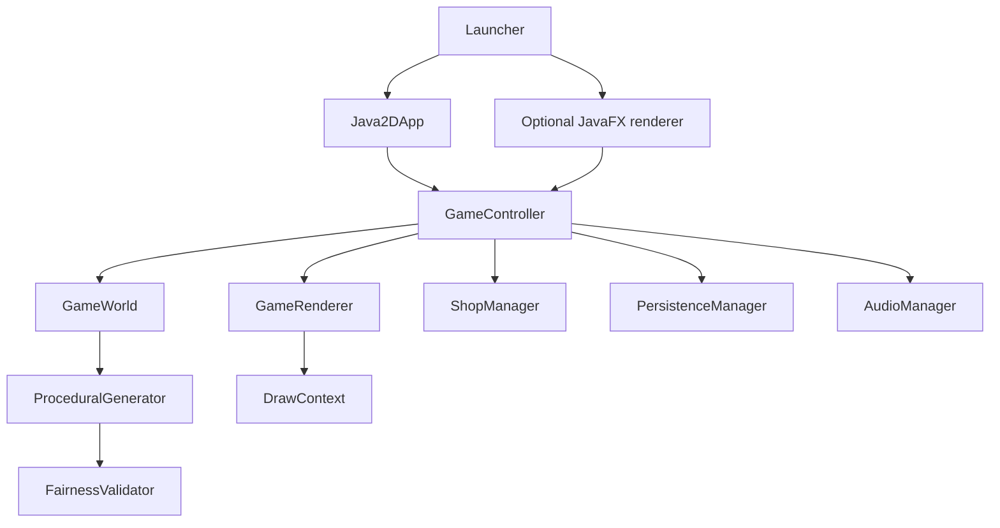

# Dodging Cat

**Dodging Cat** is a Java desktop survival platformer in which players try to stay alive for as long as possible by moving between platforms, avoiding hazards, and collecting useful items. The game supports both **single-player** and **local two-player co-op**, allowing one or two players to share the same game session and compete against an increasingly challenging environment.

During each run, the game generates platforms and hazards, including falling objects, lasers, cannonballs, and moving orbital hazards. Players can collect fish and temporary buffs to improve their chances of survival. Fish earned during gameplay also contribute to the game's progression system, where players can unlock maps and obtain character skins through the shop and gacha system. The project brings together game logic, rendering, input handling, collision detection, procedural generation, audio, and local data persistence in one Java application.

## 1. Project Information

| Field | Details |
|---|---|
| Project | Dodging Cat |
| Course | Java Software Development |
| Group | Team TADQ |
| Members | Hoang Kien Quyet; Tran Quang Anh; Nguyen Cong Doan; Tran Gia Thanh |
| Build tool | Maven |
| Java target | JDK 25 |
| Repository | [HoangKienQuyet/DodgingCat](https://github.com/HoangKienQuyet/DodgingCat) |

### Team responsibilities

The four members initially developed **four separate game demos**, with each member pushing their own version to an individual GitHub branch. After completing the demos, the group held a meeting to review and compare the versions. The team then selected the demo considered the strongest overall as the foundation for the final project. All four members subsequently participated in developing and improving the selected demo to complete the project.

The selected demo was used as a starting point, not as the only contribution to the final result. Specific implementation tasks and individual contributions should be described separately in the project report based on the work actually completed by each member.

## 2. Project Overview

### Problem
A survival platform game needs responsive controls, a continuously updated game world, varied obstacles, and a difficulty curve that challenges players without relying entirely on unpredictable hazard placement. It also needs clear separation between gameplay, rendering, user interaction, and saved progress so that the application can be maintained and extended.

### Motivation
This project applies Java programming and object-oriented design to an interactive desktop game. It provides practical experience with game loops, event handling, collision detection, procedural generation, graphical rendering, file persistence, audio, and software testing.

### Objectives
- Develop a playable Java desktop survival platformer.
- Support single-player and local two-player cooperative gameplay.
- Generate platforms and hazards during gameplay.
- Provide collectible buffs, fish currency, maps, skins, a shop, and a leaderboard.
- Save player progression between application sessions.
- Organize the code into components with clear responsibilities.

### Scope
**Included:** desktop gameplay, local co-op, keyboard/mouse input, maps and skins, shop/gacha, buffs and fish collection, JSON profile persistence, audio, leaderboard, English/Vietnamese UI strings, and automated tests.

**Outside the current scope:** online multiplayer, cloud accounts or synchronization, online leaderboards, and resuming a game after the player leaves the current run.

## 3. Main Features

- **Single-player and local co-op:** supports one or two players in a shared run.
- **Platforming:** horizontal movement, jumping, and dropping through elevated one-way platforms.
- **Procedural platforms:** creates randomized platform layouts with layout and jump-reachability checks.
- **Hazards:** includes falling objects, warning-based lasers and cannonballs, and orbital or swinging hazards.
- **Fairness filtering:** checks candidate hazards using spawn spacing, active-hazard limits, safe zones, warning states, estimated reaction time, and orbital clearance.
- **Buffs:** includes Double Score, Bomb, Invincibility, Shield, and a co-op Heart/revive effect.
- **Fish currency:** players collect Fresh Fish and Canned Fish during a run and receive run rewards at Game Over.
- **Shop and gacha:** provides map purchases, skin unlocks, weighted rarity selection, and a staged reveal animation.
- **Profile and leaderboard:** stores progression and loadout data, with separate Single and Co-op leaderboard lists.
- **Audio and visual effects:** includes background music, sound effects, particles, screen shake, and special skin effects.
- **Window options:** supports fullscreen mode and an optional FPS display.

## 4. System Architecture



`Launcher` selects the Java2D/AWT renderer by default. The optional JavaFX renderer can be selected with `-Ddodgingcat.renderer=javafx`. Both rendering paths use shared game coordination and gameplay components. JavaFX remains a runtime dependency for image/media and related UI types even when Java2D is selected as the main renderer.

### Main component responsibilities

| Component/package | Main responsibility |
|---|---|
| `Launcher` | Starts the application and selects the renderer. |
| `app` | Window setup, render loop, frame pacing, and render surface. |
| `core` | Game states, navigation, countdown, pause, and game-over coordination. |
| `game` | Player movement, platforms, world updates, collision interactions, and collection logic. |
| `generation` | Platform/hazard generation, spawn scheduling, difficulty, fairness checks, and generation metrics. |
| `hazards` and `buffs` | Hazard behavior and collectible buff effects. |
| `collision` | Hitbox and collision helper utilities. |
| `shop` | Map/skin catalog, purchases, gacha selection, and reveal sequence. |
| `persistence` | Profile loading/saving and leaderboard data. |
| `ui` | Game screens, UI components, assets, text, particles, and visual effects. |
| `audio` | Music, sound effects, and playback coordination. |
| `input` and `i18n` | Keyboard/mouse input mapping and English/Vietnamese text. |

The main game states include `BOOT`, `MENU`, `PRE_GAME_SELECT`, `COUNTDOWN`, `PLAYING_SINGLE`, `PLAYING_COOP`, `PAUSED`, `GAME_OVER`, `SHOP`, `LEADERBOARD`, and `ABOUT_US`.

## 5. Java Design

This section shows four Java design concepts through short excerpts from the project's actual classes. The snippets omit unrelated code and imports so the relevant class relationships are easier to see.

### Encapsulation — `Player`

`Player` keeps movement and life state private; movement is changed through methods that enforce the alive-state check.

```java
private double vx;
private boolean alive = true;
private final double moveSpeed = 260.0;

public void moveRight() {
    if (!alive) return;
    this.vx = moveSpeed;
    this.facingDirection = 1;
}
```

### Composition — `GameWorld`

`GameWorld` owns collections of the objects that make up a run.

```java
private final List<Player> players = new ArrayList<>();
private final List<Platform> platforms = new ArrayList<>();
private final List<Hazard> hazards = new ArrayList<>();
private final List<Buff> buffs = new ArrayList<>();
```

### Polymorphism — `Hazard` subclasses

`GameWorld` handles every hazard through the `Hazard` type. Each concrete hazard provides its own `collidesWith` implementation, so the call uses the actual hazard's collision behavior.

```java
for (Hazard hazard : hazards) {
    hazard.update(dt, width, height);
    for (Player player : players) {
        if (player.isAlive() && !player.isInvincible() && hazard.collidesWith(player)) {
            player.applyHit();
        }
    }
}
```

### Separation of concerns — `GameController`

`GameController` coordinates input and state transitions, then delegates the world simulation to `GameWorld`.

```java
activeWorld.update(dt);
```

These are examples of the project's class responsibilities, not claims that it implements a particular SOLID principle or named design pattern.

For more detailed class and state relationships, see [Architecture and source map](docs/architecture.md).

## 6. Technical Implementation

The project uses the following technologies and implementation techniques:

- **Language and build:** Java 25 and Maven.
- **GUI and rendering:** Java2D/AWT (`Canvas`, `BufferStrategy`, `Graphics2D`) as the default rendering path; JavaFX as an optional renderer and for related UI/media support.
- **Game execution:** a frame-based game loop with a target of 60 FPS, input processing, game-state management, and frame pacing.
- **Concurrency:** background workers are used for selected asset preparation and audio preparation; AWT input events are processed by the game thread.
- **Graphics optimization:** caches are used for scaled images, backgrounds, panels, borders, and rasterized text to reduce repeated rendering work.
- **Procedural generation:** platforms and hazards are generated using spawn rules, difficulty parameters, validation checks, and bounded attempts.
- **Collision detection:** hitboxes and collision helper utilities are used to detect interactions between game objects.
- **File I/O and persistence:** Gson stores player profile and progression data in a local JSON file.
- **Testing:** JUnit 5 is used for automated tests, including game logic and selected UI checks.

The profile is saved by `PersistenceManager` to the following default location:

```text
${user.home}/.dodgingcat/dodging_cat_profile.json
```

The path can be overridden with `-Ddodgingcat.profile=<path>` or `-Ddodgingcat.profilePathFile=<path-to-text-file>`. The frame-rate target is not a guarantee; actual performance depends on the computer and the scene being rendered.

## 7. Project Structure

```text
DodgingCat/
├── src/
│   ├── main/
│   │   ├── java/com/dodgingcat/
│   │   └── resources/assets/
│   └── test/java/com/dodgingcat/
├── docs/
├── tools/
├── pom.xml
├── dev.ps1
├── run.cmd
├── test.cmd
└── README.md
```

- `src/main/java/`: application and game source code.
- `src/main/resources/assets/`: image and audio resources.
- `src/test/java/`: automated tests and selected UI/desktop probes.
- `docs/`: architecture, gameplay, setup, testing, and performance documentation.
- `tools/`: asset generators, packaging scripts, and helper templates.
- `pom.xml`: Java version, dependencies, and Maven plugin configuration.
- `dev.ps1`, `run.cmd`, `test.cmd`: development, launch, and test helpers.

## 8. Requirements

- **JDK:** Java Development Kit 25.
- **Build tool:** Apache Maven (the Windows helper can download Maven 3.9.11 if it is not installed).
- **Internet:** required for Maven to download dependencies during the first build.
- **Environment:** a desktop operating system with graphics support to run the game and UI snapshot tests.

No external database is required. Player profile and leaderboard data are stored locally in a JSON file. Performance depends on the computer, display resolution, and other running applications; no specific GPU minimum is claimed.

## 9. Installation

1. Install JDK 25 and make sure `java` and `javac` are available in the terminal.
2. Install Maven, or use the provided Windows helper to download Maven when necessary.
3. Clone the repository and enter the project directory:

   ```bash
   git clone https://github.com/HoangKienQuyet/DodgingCat.git
   cd DodgingCat
   ```

   The project source is maintained on the repository's `main` branch. No branch switch is required when cloning the latest version from `main`.

4. Check that `JAVA_HOME` points to JDK 25.
5. Build and test the project using the commands in the next section.

## 10. Run

Run commands from the directory containing `pom.xml`.

### Compile and launch

```powershell
mvn compile javafx:run
```

The Maven goal is `javafx:run`; `Launcher` selects Java2D/AWT by default. To use the optional JavaFX renderer, set `-Ddodgingcat.renderer=javafx` as a JVM system property in the IDE run configuration for `com.dodgingcat.Launcher`.

### Windows helpers

```powershell
.\run.cmd
.\test.cmd
```

The helpers call `dev.ps1`. A normal Maven build creates output under `target/`; the generated JAR is not a self-contained package with its own Java runtime and all dependencies.

### Controls

| Action | Player 1 | Player 2 |
|---|---|---|
| Move left/right | `A` / `D` | `Left` / `Right` |
| Jump | `W` | `Up` |
| Drop through platforms | `S` | `Down` |
| Pause/resume | `Esc` or `P` | Shared game state |
| Restart | `R` | Shared game state |
| Return to menu while paused | `M` | Shared game state |
| Fullscreen/windowed | `F11` | — |
| Toggle FPS display | `F10` | — |

Use the mouse for menu buttons and map selection. `Tab` switches Map/Skin tabs. In two-player skin selection, P1 uses WASD plus Space and P2 uses arrow keys plus Enter; clicking a skin changes P1. Losing window focus while playing automatically pauses the game and clears held-key state.

**Development-only warning:** `F9` enables a development-money mode. Pressing `F9` again resets the profile to first-player defaults, including unlocks, wallet, and leaderboards. Do not use it on a profile you want to keep.

For detailed gameplay and save behavior, see [Run, play and test](docs/running-and-testing.md).

## 11. Testing and Results

Run the automated test suite with:

```bash
mvn test
```

On Windows, you can also run:

```powershell
.\test.cmd
```

The documented test suite covers buff behavior and cooldowns, fish collection, player/platform logic, fairness and difficulty, profile save/load, gacha, audio formatting, and selected UI snapshots. UI snapshot tests start JavaFX and require a desktop graphics environment, so the entire suite is not guaranteed to run in a fully headless environment. Test reports are generated in `target/surefire-reports/`, while UI previews are written to `target/ui-preview/`.

The project documentation records a test run from **28 October 2026** with the following results:

| Measure | Recorded result |
|---|---:|
| Tests discovered | 50 |
| Passed | 44 |
| Optional probes skipped | 6 |
| Failures / errors | 0 / 0 |

These are previously recorded results, not a fresh test execution during this README revision. Run `mvn test` on the final `main` revision and update this table if the results change. For manual verification, record the actual result after executing each scenario; do not mark an untested case as passed.

## 12. Experimental Evaluation

The project's performance notes record native Java2D measurements from **28 October 2026**. Selected menu, shop, two-player gameplay, spin, and legendary-reveal scenes ran at approximately 60 FPS at windowed 1200×800 and fullscreen 1920×1080. An application probe recorded approximately 60.00 FPS after warmup and about 4.005 seconds from the title screen to the menu. One shop probe recorded a frame time of 25.22 ms.

These are historical measurements from one Windows machine and selected scenes; they are not a guarantee for other computers or every gameplay situation. For a reproducible evaluation, record the operating system, JDK, GPU, display resolution, window size, warmup time, sampling duration, average FPS, and frame-time results. See [Performance and verification](docs/performance.md) for measurement details.

## 13. Novelty and Technical Contributions

The main technical contributions of the project are:

1. **Fairness-aware hazard admission:** hazard candidates are checked against spawn spacing, active-hazard limits, safe zones, warning requirements, estimated reaction time, and orbital clearance before being accepted. Rejection reasons are recorded for analysis.
2. **Procedural platform generation:** platform layouts are randomized and checked using layout and jump-reachability heuristics, with bounded generation attempts and fallback behavior.
3. **Java2D rendering and optimization:** the native rendering path uses `BufferStrategy` and `Graphics2D`, with caches for scaled images, backgrounds, panels, borders, and rasterized text to reduce repeated work.
4. **Integrated local co-op and progression:** shared two-player gameplay is combined with buffs, fish rewards, map/skin unlocks, gacha, JSON profile saving, and separate Single/Co-op leaderboards.
5. **Automated verification:** logic tests, UI snapshots, and optional desktop probes support regression testing and performance investigation.

These contributions aim to improve gameplay variety, reduce some unfair hazard combinations, avoid unnecessary rendering work, and make the project easier to test. The fairness checks are heuristic and do not prove that every generated situation is solvable. Performance improvements also do not guarantee a fixed frame rate on all hardware.

## 14. Limitations

- The project is a desktop game and does not currently provide online multiplayer, cloud saves, or online leaderboards.
- Player data is stored in a local JSON file; the current save flow does not guarantee atomic writes or automatic backups.
- A paused run is discarded when the player returns to the menu; it cannot be resumed later.
- Fairness validation and platform reachability use heuristics rather than a complete proof that every generated situation is solvable.
- The 60 FPS target and recorded performance results depend on hardware and runtime conditions.
- UI snapshot tests require a desktop graphics environment.

## 15. References

### Project documentation
- [Architecture and source map](docs/architecture.md)
- [Run, play and test](docs/running-and-testing.md)
- [Performance and verification](docs/performance.md)
- [Gameplay parameters](docs/gameplay-thong-so.md)
- [Shop, gacha and loadout](docs/shop-and-loadout.md)

### Technology documentation
- [Java](https://docs.oracle.com/en/java/)
- [Apache Maven](https://maven.apache.org/guides/)
- [OpenJFX](https://openjfx.io/openjfx-docs/)
- [Gson](https://github.com/google/gson)
- [JUnit 5](https://junit.org/junit5/docs/current/user-guide/)

---

**Repository:** [HoangKienQuyet/DodgingCat](https://github.com/HoangKienQuyet/DodgingCat) · **Main development branch:** `main`
