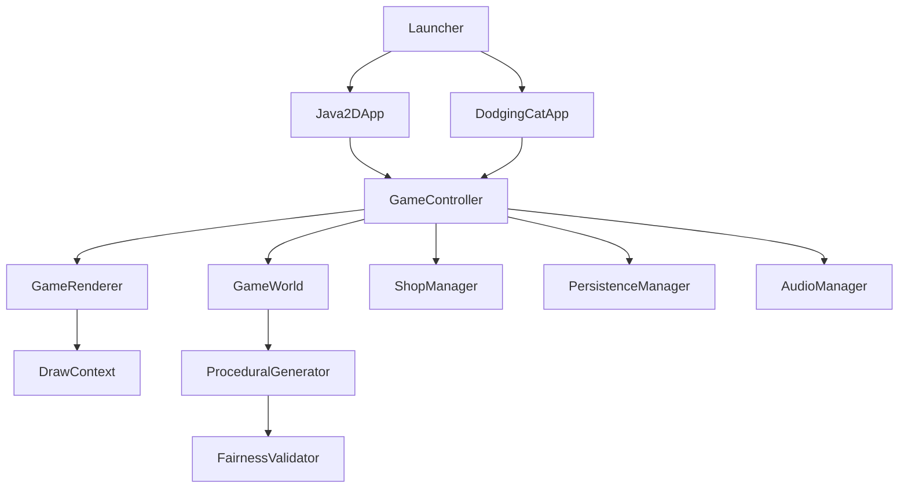

# Kiến trúc và bản đồ mã nguồn

[Mục lục](README.md) · [README English](../README.md) · [README tiếng Việt](../README_vi.md)

## Luồng ứng dụng

[Launcher](../src/main/java/com/dodgingcat/Launcher.java) mặc định gọi `Java2DApp`; property `dodgingcat.renderer=javafx` chọn `DodgingCatApp`. Cả hai dùng cùng `GameController`, `GameWorld`, renderer và assets. JavaFX vẫn khởi động cho image/media và kiểu dữ liệu UI; Java2D không đồng nghĩa loại bỏ dependency JavaFX.

State hiện có trong [GameState](../src/main/java/com/dodgingcat/core/GameState.java): `BOOT → MENU → PRE_GAME_SELECT → COUNTDOWN → PLAYING_SINGLE/PLAYING_COOP → PAUSED/GAME_OVER`. Menu còn mở `SHOP`, `LEADERBOARD`, `ABOUT_US`. Không có state Settings hoặc ván suspend để resume từ menu. Pause resume world còn trong RAM; về menu bỏ world đó.

## Các vùng code

| Package | Trách nhiệm thực tế |
| --- | --- |
| [app](../src/main/java/com/dodgingcat/app) | Window, DPI, fullscreen, render loop; FramePacer/RenderSurface; PortableAssets phục vụ gói legacy |
| [core](../src/main/java/com/dodgingcat/core) | State, điều hướng, input action, đếm ngược, kết thúc/lưu trận, đồng bộ BGM/gacha |
| [game](../src/main/java/com/dodgingcat/game) | Player physics, platform, fish, world update và va chạm/nhặt đồ; PateItem/PateType là lớp tương thích cũ, world hiện dùng FishItem/FishType |
| [generation](../src/main/java/com/dodgingcat/generation) | Lịch spawn, difficulty, chọn buff/cá/hazard, kiểm tra fairness và đổi platform |
| [hazards](../src/main/java/com/dodgingcat/hazards) | Falling, laser, cannon, orbital; HorizontalHazard còn cho nhánh tương thích/test nhưng generator hiện không sinh loại này |
| [buffs](../src/main/java/com/dodgingcat/buffs) | Pickup và loại buff; tác dụng được áp dụng bởi GameWorld/Player |
| [collision](../src/main/java/com/dodgingcat/collision) | Hitbox AABB và helper collision; physics/va chạm gameplay chính thực hiện trong Player, Platform, Hazard và GameWorld |
| [shop](../src/main/java/com/dodgingcat/shop) | Catalog, quyền sở hữu, mua map, chọn giải có trọng số và state trình diễn gacha |
| [persistence](../src/main/java/com/dodgingcat/persistence) | GameData, JSON profile, leaderboard |
| [ui](../src/main/java/com/dodgingcat/ui) | Vẽ scene/UI, chữ raster, asset/cache, particles, screen shake, gacha effects |
| [audio](../src/main/java/com/dodgingcat/audio) | Resolve WAV/MP3, MediaPlayer BGM, SFX PCM/Clip pool, tracked playback |
| [input](../src/main/java/com/dodgingcat/input) / [i18n](../src/main/java/com/dodgingcat/i18n) | Phím/chuột và transition mỗi frame; chuỗi English/Việt |

## Loop và tọa độ

Java2D dùng AWT Canvas + BufferStrategy hai buffer, vẽ qua Graphics2D. `FramePacer(60)` chờ deadline bằng đồng hồ nano; bỏ nhịp cũ khi chậm, không xếp hàng nhiều frame để chạy bù. Event AWT được xếp hàng rồi xử lý trên luồng game. Window được tạo/đổi mode qua Swing event thread. Đây là loop timestep biến thiên: ngoài boot, `dt` bị chặn tối đa 0,05s; không phải fixed-step simulation 60 Hz.

Chiều cao logic 640; chiều rộng logic = tỉ lệ viewport × 640. Pixel render theo kích thước vật lý có xét DPI, không framebuffer 720p mặc định. World resize cùng viewport, ảnh và sprite giữ tỉ lệ. Mặt sàn mọi map ở `height × 0.8555`. MapBackdropCache/DrawContext cache nền, ảnh đã scale và panel; AssetManager chuẩn bị bounds/preview trên worker. [Hiệu năng](performance.md) giải thích phần đo và giới hạn.

## Simulation và collision

`GameWorld.update` cộng thời gian/điểm, update platform, physics người chơi, generator, hazard/collision, buff, fish, particles rồi kiểm tra tất cả người chơi chết. Chỉ state đang chơi gọi update world; pause/countdown không làm timer gameplay chạy tiếp.

Player có sprite logic 36×36, hình mèo được vẽ lớn hơn. Hitbox hazard có offset (-8, -26), cỡ 52×60; vùng bàn chân dùng riêng để đáp platform, cần overlap tối thiểu 22% chiều rộng sprite. Bệ nổi chỉ đỡ khi chân đi từ phía trên xuống và `vy >= 0`; giữ phím xuống bỏ collision bệ nổi. Sàn vẫn luôn đỡ. Một đòn không được bảo vệ làm mèo chết; Shield chặn một đòn rồi cho 1s miễn sát thương, Invincibility cho hazard xuyên qua. Các giá trị vật lý và spawn ở [gameplay](gameplay-thong-so.md).

## Fairness: phạm vi thực sự

[FairnessValidator](../src/main/java/com/dodgingcat/generation/FairnessValidator.java) kiểm tra ứng viên trước khi đưa vào world:

1. Khoảng spawn tối thiểu 0,35s và giới hạn active theo giai đoạn; tối đa hai orbital.
2. Safe-zone của vật rơi: kiểm tra khoảng X/Y quanh người sống; laser/cannon phải đang warning.
3. Vật rơi phải có thời gian va chạm ước tính ít nhất 0,40s, dùng khoảng cách dọc chia vận tốc đầu. Phép ước tính này không giải phương trình có gia tốc và không kiểm tra mọi quỹ đạo né tương lai.
4. Orbital phải có clearance dự báo ít nhất 30 trong 0,75s.
5. Không nhận thêm ứng viên laser/cannon khi đã có hai kênh warning.

Mỗi lần sinh thử tối đa sáu ứng viên. `FairnessMetrics` ghi số accepted/rejected và lý do; invalid rate là rejected/total (0 nếu chưa có ứng viên). Đây là các luật chọn spawn định lượng, không phải AI thích nghi hoặc bằng chứng mọi tổ hợp hazard luôn có lối thoát. Tham số `platforms` truyền vào validator hiện không được dùng để tìm đường né. Các kiểm tra mạng platform nằm riêng trong GameWorld/ProceduralGenerator.

Luồng gacha và thời điểm save nằm ở [shop](shop-and-loadout.md) và [running-and-testing](running-and-testing.md). Không suy chức năng từ tên lớp/comment cũ nếu code gọi thực tế khác.
